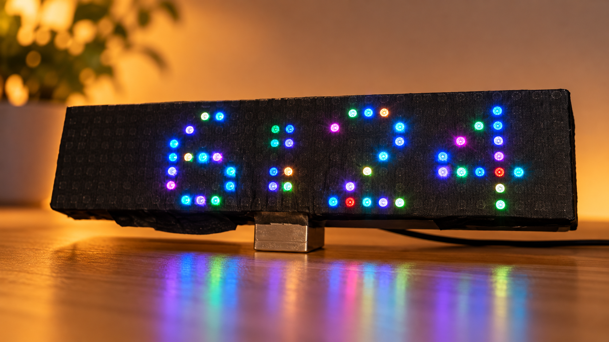

# ESP Siesta Clock with Matrix Display

**2026 by HexOhm**

> **A clever, super-dark clock that respects your sleep.**

The **ESP Siesta Clock with Matrix Display** is an ESP8266-based 32 x 8 RGB matrix clock designed around a simple idea: a clock should be easy to read when you need it, colorful when you want it, and almost disappear when you sleep.

It combines a DS3231 real-time clock, automatic WiFi/NTP synchronization, a bilingual OLED setup interface, direct NEC infrared remote control, seasonal Siesta quiet-hour schedules, Night Mode dimming, public-holiday and weekend rules, selectable fonts, and multiple color modes.

The project deliberately keeps WiFi off between synchronization sessions. The RTC remains the continuous time source, while WiFi is used only when configuration, time synchronization, or public-holiday refresh is needed.

## Highlights

- **Super-dark Night Mode** - brightness is forced to the minimum level at night and other display effects are prevented from raising it.
- **Seasonal Siesta schedules** - separate Summer and Winter daytime/nighttime quiet-hour periods with editable calendar ranges.
- **Automatic time synchronization** - NTP corrects the DS3231 at a user-selectable AUTOSYNC interval.
- **RTC fallback** - the clock continues normally from the DS3231 even when WiFi or Internet is unavailable.
- **WiFi only when needed** - normal operation does not require a permanent WiFi connection.
- **249-country selector** for public-holiday data.
- **63 compact timezone rules** for practical civil-time/DST behavior.
- **Holidays + weekends** - independently enable Public Holidays, Saturdays and Sundays and assign a common Night Mode end-time override.
- **Bilingual OLED interface** - English and Greek.
- **12/24-hour display**.
- **6 selectable matrix font styles**.
- **16 mono colors** plus Solid, Colorful, Funny and Dynamic daytime color modes.
- **Direct NEC remote decoder** - no IRremote library is required by this firmware.
- **Persistent settings** stored in EEPROM.
- **Breathing center separator** and PM indicator on the RGB matrix.

## Hardware used

| Part | Purpose |
|---|---|
| ESP8266 / NodeMCU-class board | Main controller and WiFi |
| DS3231 RTC | Continuous timekeeping |
| 32 x 8 WS2812 RGB matrix (256 LEDs) | Main clock display |
| SSD1306 128 x 64 I2C OLED | Menus, setup and status |
| NEC IR receiver + remote | User control |
| Push button | Boot-time WiFi configuration |
| 5 V power supply | System / matrix power as appropriate for the build |

### Firmware pin assignment

| Function | GPIO |
|---|---:|
| WS2812 matrix data | 13 |
| IR receiver | 14 |
| Boot/config button | 0 |
| I2C SDA | 4 |
| I2C SCL | 5 |

## Firmware

The public repository contains **only the final working firmware**, renamed for publication:

`firmware/ESP_Siesta_Clock_with_Matrix_Display.ino`

Publication source identity:

- Lines: **7,981**
- Bytes: **177,344**
- SHA-256: `668ae363facd19c0a8dac44238cdccaea5a419ad1290b60b41b251194a177ec1`

The repository contains the verified final firmware logic with concise operational comments only.

## Arduino libraries / headers used

- ESP8266WiFi
- ESP8266HTTPClient
- WiFiClientSecureBearSSL
- TZ
- WiFiManager
- NTPClient
- WiFiUdp
- Adafruit_NeoPixel
- EEPROM
- U8g2lib
- RTClib

## Everyday operation

At normal power-up the clock attempts a bounded connection using previously saved WiFi credentials. If connected, it synchronizes network time, updates the DS3231, optionally refreshes public-holiday data when that rule is enabled, and then turns WiFi off. If WiFi is unavailable, the clock simply continues from the RTC.

Hold the hardware configuration button during boot to enter WiFi setup. The clock opens the WiFiManager access point **AutoConnectAP**; the OLED directs the user to **192.168.4.1**.

## Main OLED menu

Country · Time Zone · Time · 12/24 Hour · Fonts · Siesta · Night Mode · Holidays · Dimmer · AUTOSYNC · SYNC NOW · Mono Color · Multi Color · Language

## Sleep-first design

Night Mode is intentionally treated as the brightness authority. When the clock is inside its night schedule, brightness is clamped to the minimum value. Menu colors and other display effects are not allowed to defeat the dimming rule.

Holidays can change only the **Night Mode end time** for a matching date. Public holidays, Saturdays and Sundays are independent options. This makes it possible, for example, to keep the clock super-dark later on weekends without changing the normal weekday schedule.

## Siesta / quiet hours

Factory defaults in the firmware follow the Greek quiet-hours schedule encoded in the project:

| Season | Day period | Night period | Date range |
|---|---|---|---|
| Summer | 15:00-17:30 | 23:00-07:00 | 01/04-30/09 |
| Winter | 15:30-17:30 | 22:00-07:30 | 01/10-31/03 |

All eight seasonal values are edited transactionally: invalid or incomplete edits are not committed.

## Documentation

- [User Manual - English](docs/ESP_Siesta_Clock_User_Manual_EN.pdf)
- [Εγχειρίδιο Χρήσης - Ελληνικά](docs/ESP_Siesta_Clock_User_Manual_GR.pdf)
- [Technical Reference - English](docs/ESP_Siesta_Clock_Technical_Reference_EN.pdf)
- [Τεχνική Αναφορά - Ελληνικά](docs/ESP_Siesta_Clock_Technical_Reference_GR.pdf)
- [Build and Upload Notes](docs/BUILD_AND_UPLOAD.md)

## Media

The `media/` folder contains the project hero image, original device/construction photographs, and a short demonstration video.

## As-is

This project is provided as-is.

---

**2026 by HexOhm**
